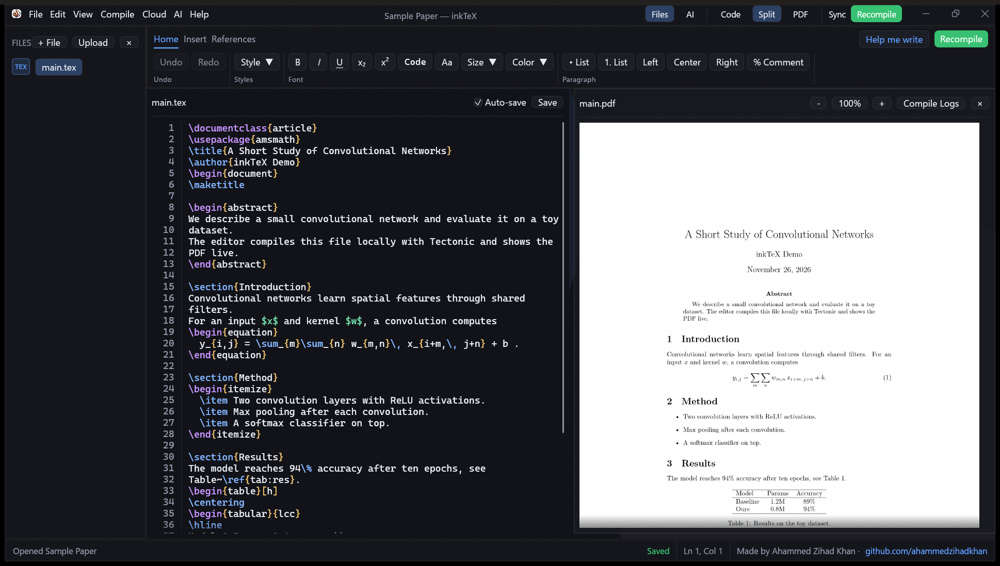
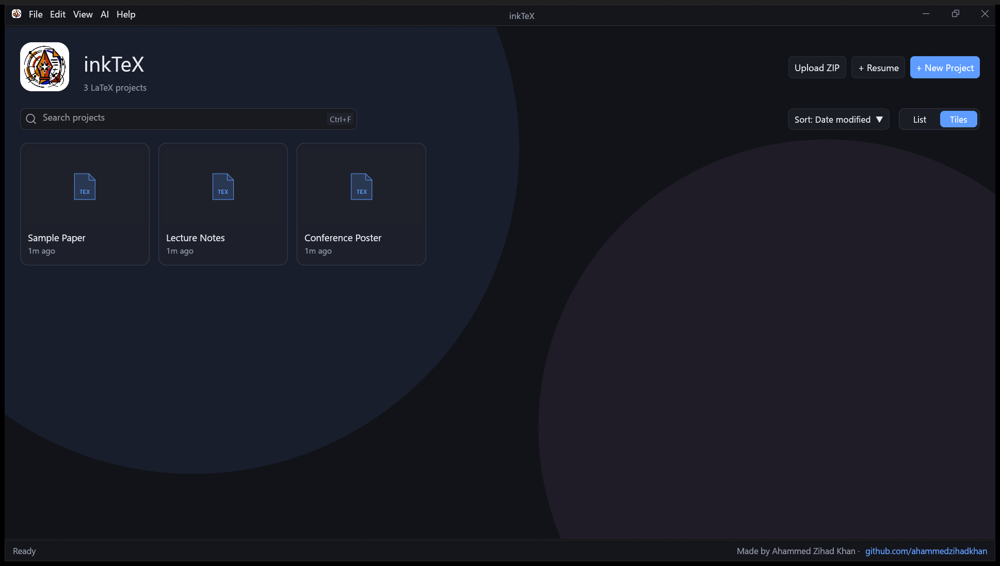

# inkTeX (Pure Rust Desktop App)

An AI-powered local LaTeX desktop editor laid out like Overleaf with a geometric drafting design aesthetic. It features a file tree, highlighted code editor, live PDF preview with Recompile, logs view, and built-in AI Assist (Claude, Gemini, or local Ollama models) to fix compile errors and rewrite sections.





## Why inkTeX instead of Overleaf?

| | inkTeX | Overleaf (free plan) |
|---|---|---|
| **Works offline** | Yes, everything runs on your PC | No, needs internet |
| **Compile time limit** | None, big theses compile fully | Short timeout on large projects |
| **Collaborators / projects** | No limits | Limited collaborators per project |
| **Your files** | Plain folders on your disk, use Git or any tool | Stored on Overleaf's servers |
| **AI help** | Built in: Claude, Gemini, or free local Ollama models fix errors and rewrite text, shown as a diff you accept | Paid add-on |
| **Install LaTeX?** | No, Tectonic downloads itself and fetches packages on demand | No |
| **Privacy** | Papers never leave your PC (unless you turn on Drive sync) | Uploaded to the cloud |
| **Extras** | Google Drive sync, Overleaf ZIP import, PDF history, neural-network diagram builder, one-click resume | Templates gallery |
| **Speed** | Native Rust app, instant typing and PDF view | Browser-based |
| **Cost** | Free and open source (GPL-3.0) | Free tier, paid plans for more |

Overleaf is still the better pick for real-time co-editing in the browser with people who don't install anything.

## Build (once)
Needs Rust and the Visual Studio C++ Build Tools.
```
cargo build --release
```
The program is `target/release/inktex.exe`, a single, self-contained desktop app with the UI and logo embedded.

Made by **Ahammed Zihad Khan** · [github.com/ahammedzihadkhan](https://github.com/ahammedzihadkhan)

## Run
```
inktex.exe
```
Or start via `Run-inkTeX.bat`, `Run-inkTeX-Silent.vbs` (no console window) or stop it with `Stop-inkTeX.bat` (these expect `inkTeX.exe` next to them).

It opens the **inkTeX** desktop application window. Each project is a folder in `Documents\TeX Projects` (created on first run).

- **＋ Resume** creates and opens a one-page resume in one click (the sb2nov template below, with your profile's name and email).
- **New project** creates a folder with a starter `main.tex`. Pick **Blank paper**, or **Resume / CV**, which is [sb2nov/resume](https://github.com/sb2nov/resume) (MIT, `templates/LICENSE-resume`) filled in with your profile's name and email.
- **Upload ZIP** imports a zipped LaTeX project, for example one downloaded from Overleaf (Menu → Download → Source). A zip that holds a single folder is unwrapped. Limit: 200 MB.
- **PDF history** lists the PDFs from past successful compiles; click one to open it. Each project keeps its newest 10 in a hidden `.history` folder, and older ones are deleted automatically.
- **Profile** stores your name, affiliation and email (in `.profile.json` in the projects folder). New projects put your name and affiliation in `\author{}`. It also shows whether your Claude and Gemini keys are set, and which LaTeX compiler is used.
- **Logs** lists recent activity: compiles (result, error count, time taken, first error), AI requests, uploads and new projects. The newest 1000 entries are kept in `.activity.log`.

Other ways to start it:
```
inktex.exe "D:\My Papers"           # use another projects folder
inktex.exe "D:\My Papers\thesis"    # open one paper directly (a folder with a .tex file)
```

## Built-in LaTeX compiler
You don't need to install LaTeX. On the first Recompile, if no compiler is on the PC, the app downloads the **Tectonic** engine to `%LOCALAPPDATA%\texcraft-ai\`. Tectonic then fetches the LaTeX packages your paper uses, so the first build takes a minute and needs internet. Later builds are fast. If you already have MiKTeX, TeX Live or Tectonic installed, the app uses that instead.

## AI models
Use any of these. The chat lists only the ones that are set up.
```
setx ANTHROPIC_API_KEY "sk-ant-..."   # Claude
setx GEMINI_API_KEY "..."             # Gemini
```
Open a new terminal afterwards. You only need the key for the model you use.

**Free, local, no key:** install [Ollama](https://ollama.com) and pull a model, for example `ollama pull llama3.2`. Every model it has shows up in the chat as "Local · …". `OLLAMA_URL` changes the address (default `http://127.0.0.1:11434`).

## Using it
- Opening a project shows its last built PDF straight away, without recompiling.
- Drag the bar between the code and the PDF to resize them (double-click resets to half and half; arrow keys work when it's focused). The split is remembered.
- **Files** groups each folder (chapters, figures, tables…) into a collapsible section. Clicking an image previews it over the PDF; **Close preview** brings the PDF back as it was.
- **Upload image** (PNG, JPG, PDF, EPS) saves the picture into the project's `figures/` folder (or the top level if there's none) and inserts `\includegraphics[width=\linewidth]{…}` at the cursor. Ctrl+Z undoes the insert. Your preamble needs `\usepackage{graphicx}`.
- The **formatting bar** above the code works like Word's and Overleaf's:
  - **Heading**, **B**, *I* and U (Ctrl+B, Ctrl+I, Ctrl+U) wrap the selection. Pressing one again removes it.
  - $x$ for inline math, ∑ for an equation, and bulleted or numbered lists (each selected line becomes an item).
  - **Image** opens a dialog. Pick or upload an image, then set its width, alignment, position and caption. Position works like Word's anchor options: best fit, here, exactly here, top, bottom, own page, or text wrapping with the image on the left or right.
  - **Table** opens a dialog for rows, columns, cell alignment, position and caption.
  - Ref, Cite, Footnote, Comment (Ctrl+/), Undo and Redo.
  - **αβ Symbols** opens equation tools: structures (fractions, roots, sums, integrals, brackets, accents), matrices and cases, Greek, operators, relations and arrows.
  - **NN diagram** draws a neural-network figure (see below).
  - If a snippet needs a package (`graphicx`, `float`, `wrapfig`, `amsmath`) and the main file is open, the package is added to the preamble for you (Ctrl+Z undoes). In other files, the status bar says what to add.
- The top bar switches between **CODE**, **BOTH** and **PDF** views and has a **Dark** mode. Both choices are remembered. **⤓ PDF** downloads the built PDF.

### Neural-network diagrams
**NN diagram** is [PlotNeuralNet](https://github.com/HarisIqbal88/PlotNeuralNet) (MIT, `vendor/plotneuralnet/LICENSE`), with its Python generator ported to Rust (`src/nn.rs`). One click draws a ready-made CNN diagram and inserts it at the cursor (`diagrams/network.pdf`, then `network-2`, and so on). Click **✎** to change the layers. Write one layer per line:
```
conv     conv1  s=512 n=64 w=2 h=64 d=64 caption=Conv1
pool     pool1
conv     conv2  s=128 n=64 w=2 h=32 d=32 caption=Conv2
softmax  soft1  s=10 caption=Softmax gap=3
sum      sum1   gap=1.5
skip     conv1 conv2
```
- **Layer kinds:** conv, convrelu, pool, unpool, convres, convsoftmax, softmax, sum and `input file=…`.
- **Links:** `skip a b` and `connect a b` draw extra arrows between named layers.
- **Keys:**
  - `s` and `n` set the size and filter labels.
  - `w`, `h` and `d` set the box size.
  - `gap` is the space before a layer. Arrows appear when it's above 0, and pool layers default to 0 (attached).
  - `at` places a layer after a different one.
  - `caption` and `opacity` work as in PlotNeuralNet.
- **Build & insert** writes `diagrams/<name>.tex` (and its TikZ shapes in `diagrams/layers/`), builds `diagrams/<name>.pdf`, and inserts it as a figure. Because the diagram is a separate PDF, it works in any paper, including XeLaTeX ones. Rebuilding with the same name updates the PDF and keeps the previous `.tex` as `.tex.bak`. You can also open `diagrams/<name>.tex` and edit the TikZ directly.
- **Recompile** (Ctrl+Enter) saves the file and builds it. Error lines are marked in red, and **Logs** lists each error with **Go to line** and **Fix with AI**.
- **✦ AI Chat** (Ctrl+Shift+L) opens a chat like VS Code's:
  - **Context:** each question includes the open file (resent only when it has changed), your selection and the compile errors. Untick **Context** to leave them out.
  - **Streaming:** answers appear as they're written. **Stop** halts an answer.
  - **Code blocks** have **Insert**, **Replace selection** and **Copy** buttons. Ctrl+Z undoes Insert and Replace.
  - **Models:** pick Claude, Gemini or a local model per question.
  - **History:** each project keeps its chat in this browser. **＋ New chat** starts over.
- The panel's **Edit** tab is for your own instructions ("fix grammar in the abstract") or **Fix compile errors**. Select text first to have the AI change only that part. This is faster, and it's the way to work on long papers.
- The AI's changes appear as a diff (red = removed, green = added). **Accept** applies them, and Ctrl+Z undoes. If you edit that text while the AI is working, Accept refuses, so a stale answer can't overwrite your edits. Accepting a fix (**Fix compile errors**, or **Fix with AI** on an error) recompiles straight away and tells you whether errors remain.
- **Pick the model** from the menu in Chat, Edit or Help me write. One choice applies to all three: Claude Opus 5.5 / Sonnet 5.5 / Haiku 5.5 / Fable 5.2, Gemini 2.5 Pro / Flash, or any local Ollama model. Sonnet and Haiku cost less than Opus; Fable costs more.
- **✦ Help me write** (Ctrl+K, or the button in the formatting bar) works like Gemini in Google Docs. With no selection it writes at the cursor ("write the abstract", "continue writing"). With text selected it rewrites it ("improve the writing", "make it shorter", "more formal"). You see the suggestion first, then **Insert**/**Replace**, **Retry** or **Discard**. Ctrl+Z undoes. It sends only the text near the cursor (about 6,000 characters before and 2,000 after), and it writes `\cite{TODO}` instead of inventing citations.
- **Auto-save** (on by default; the checkbox next to the file name turns it off) saves 1.5 s after you stop typing, at least every 10 s while you type, when you switch windows or files, and before Recompile. The tab shows "✓ Saved", "Saving…" or "● unsaved". Ctrl+S saves straight away. Every save keeps the previous version as `file.tex.bak`.

Optional env vars: `CLAUDE_MODEL` (default `claude-opus-5-5`) and `GEMINI_MODEL` (default `gemini-2.5-pro`) set the model picked first and add it to the menu if it's not there yet. Also `PORT`.

## AI inside a local Overleaf (optional)

You can also run the real, open-source Overleaf Community Edition on this PC and add the same AI panel to it.

1. Install Docker Desktop, then start Overleaf:
   ```
   cd ..\overleaf-local
   docker compose up -d
   ```
   Open http://localhost:8080/launchpad once to create your admin account. After that, Overleaf is at http://localhost:8080.
2. In Brave, go to `brave://extensions`, turn on **Developer mode**, click **Load unpacked**, and pick the `overleaf-ai-extension` folder.
3. Keep `latex-ai-editor.exe` running (with your API key set). It's the AI backend for the extension.
4. Open a project in local Overleaf and click **✦ AI** at the bottom right. It works like the editor's panel: select text or use the whole file, review the diff, then Accept. Ctrl+Z undoes.

The extension holds no API keys. It calls `127.0.0.1:8765/api/ai`, and the app accepts that call only from `http://localhost:8080` (change with `OVERLEAF_ORIGIN`). That origin can use only `/api/ai`, never the file endpoints.

## Architecture

```
 Browser (home.html, index.html + CodeMirror, all built into the exe)
   │  GET /                     projects home page
   │  GET /api/projects         list project folders (those with a top-level .tex)
   │  GET /api/logs             activity log;  GET/POST /api/profile  your details + key/compiler status
   │  POST /api/new, /api/upload  create a project / import a zip (Windows' tar.exe unpacks it)
   │  GET /project?p=NAME       the editor; every call below carries ?p=NAME
   │  GET /api/files, /api/file list (.tex/.bib/images) and read files
   │  POST /api/save            write file (previous copy -> .bak)
   │  POST /api/image           save an uploaded image into figures/
   │  POST /api/compile         run the compiler, return errors + log + PDF name
   │  POST /api/diagram         layer list -> diagrams/NAME.tex (src/nn.rs) -> PDF
   │  POST /api/ai              send text + errors + instruction, get revised text
   │  POST /api/chat            chat turn, streamed back as JSON lines (Claude / Gemini / Ollama)
   │  GET /api/models           which chat models are set up
   │  GET /pdf                  the built PDF, or an image for preview
   ▼
 latex-ai-editor.exe  (src/main.rs, one thread per request, 127.0.0.1 only)
   ├─ projects project_dir(): one plain folder name inside the projects folder
   │           unpack(): bsdtar refuses zip entries with ".." or absolute paths
   ├─ files    safe_path(): only relative paths inside the project folder
   ├─ compile  compile_cmd(): Tectonic > latexmk > pdflatex > download Tectonic
   │           parse_errors(): "file.tex:LINE: msg" from the log
   └─ ai       ask_ai() -> api.anthropic.com (claude_text) or Gemini (gemini_text)
               refusals, blocks and truncated output are reported as errors, never applied
```

- **Single binary.** `home.html`, `index.html` and `vendor/` (CodeMirror 5.65.16) are built in with `include_str!`, so a UI change needs `cargo build`.
- **AI edits are proposals.** The server returns the AI's text. The browser diffs it against the original, and only Accept changes the editor, through CodeMirror's undo history.
- **Security.** The server listens on 127.0.0.1 only. POSTs from any other origin are refused (`bad origin`), so a website you visit can't drive it. API keys come only from environment variables and are never sent to the browser.
- **Tests.** `cargo test` covers path safety, project and image names, zip unpacking, error parsing, URL decoding, stripping the AI's code fences, and reading Claude and Gemini replies (including refused, blocked and truncated ones).
